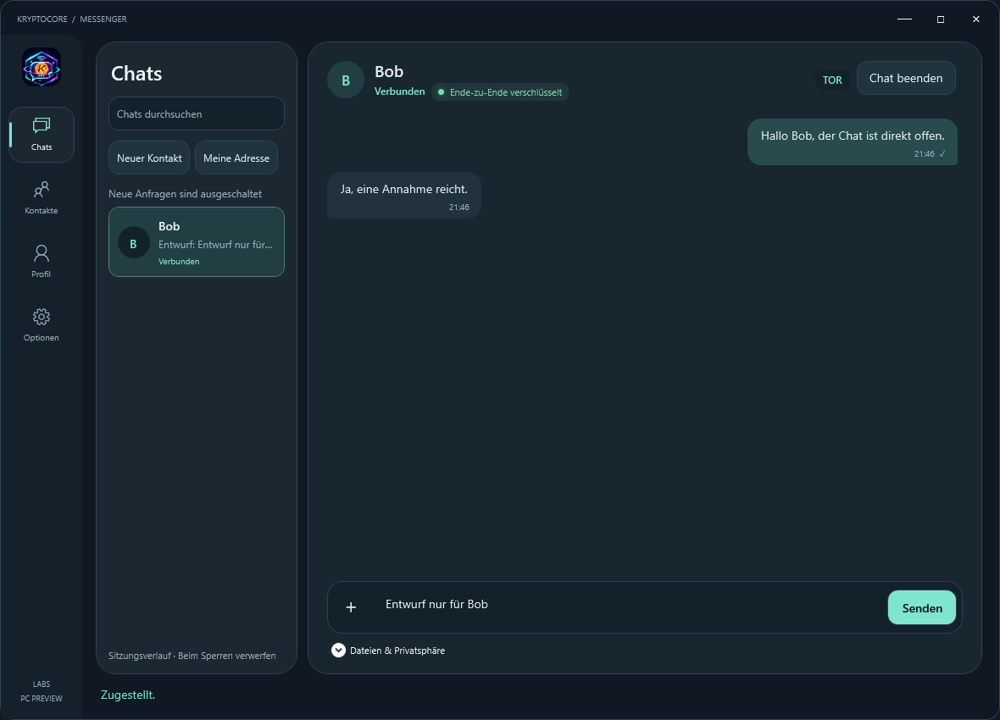

# KryptoCore MSG

[Security in 30 seconds](SECURITY-IN-BRIEF.md) · [Recover without the main app](RESCUE-FIRST.md) · [Check a download](VERIFY-DOWNLOADS.md)

[Standalone Windows builds and requirements](PORTABLE.md)

[Unreleased design preview](DESIGN.md)

Encrypted conversations and files over Tor, built on the open-source
[KryptoCore](https://github.com/kryptocorelabs/kryptocore) library.

**Experimental.** This phase focuses on reliable sessions, peer verification,
attachments and the existing encrypted stores. Protocol and store formats
are frozen while these paths are tested.
See the [canonical threat model](https://github.com/kryptocorelabs/apps-source/blob/main/apps/msg/THREAT_MODEL.md).

[Download 0.1.0-alpha.2-preview.4](https://github.com/kryptocorelabs/msg/releases/tag/v0.1.0-alpha.2-preview.4)
· [Usage](USAGE.md) · [Security](SECURITY.md) · [Release notes](RELEASE_NOTES.md)

Testing to date has been carried out by the KryptoCoreLabs maintainers, locally
and through automated CI. No independent security audit has been completed.
We welcome community testing, code reviews and scrutiny of our security
assumptions. Please use synthetic data and report suspected vulnerabilities
privately through the project's security-reporting channel.

## Source and community

[Browse the implementation](https://github.com/kryptocorelabs/apps-source/tree/main/apps/msg) or
read the [project charter](https://github.com/kryptocorelabs/kryptocore/blob/main/PROJECT_CHARTER.md). First-party code is MIT licensed;
dependencies retain their own terms. Contributions and independent review are
welcome. Source visibility does not change the documented preview limits.

## Start a conversation

1. Extract the Windows x64 ZIP and run **KryptoCore-MSG.exe**.
2. Create or unlock an identity under **Mein Profil**.
3. Under **Chats → Meine Adresse**, enable incoming requests and share your onion address privately.
4. The other person selects **Neuer Kontakt**, enters that address and requests a connection.
5. The recipient accepts. Once the authenticated channel is ready, both can chat or attach a file with **+**.

No separate Python, .NET or Tor installation is needed. Both participants
must be online. Requests require approval; protected invitations and saved
contacts are also available. Back up identity files and their sidecars together.

The channel marker stays grey when disconnected, amber while connecting,
green after the mutual encrypted handshake confirmation, and red on failure.
It authenticates the selected key; it does not establish a person's identity
or promise constant reachability. Delivery receipts are not read receipts.

## Preview limits

This preview has a compact chat interface, per-contact session drafts/messages,
contact requests, blocking and file-save prompts. One chat connects at a time.
History is held in bounded memory and cleared on lock/close/identity change.
There is no offline delivery, permanent message archive, voice calling or mobile app.
Attachments are limited to 16 MiB and are not automatically opened or scanned.

Rust protocol tests and a local two-window regression with production crypto
workers passed. That UI run uses a loopback SOCKS bridge, not the public Tor
network. A complete public-Tor run and additional two-computer/manual window
checks remain pending for this preview. It is unsigned and has no independent
security audit. Use synthetic data and retain backups.

This repository hosts public documentation and downloads. Application source
is [open under MIT](https://github.com/kryptocorelabs/apps-source/tree/main/apps/msg). Third-party components
retain their terms. The ZIP includes their original notices. See also
[Rescue](https://github.com/kryptocorelabs/rescue) for the separate offline
recovery tool; it cannot currently recover MSG identities or session history.
